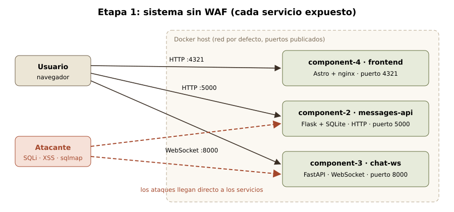
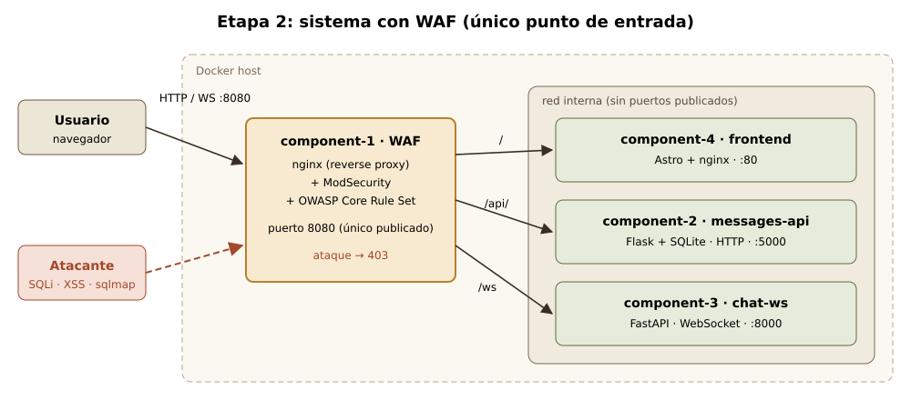

<section class="cover">
<div class="kicker">Arquitectura de Software · 2026-II · Universidad Nacional de Colombia</div>
<h1 class="title">Web Application Firewall</h1>
<p class="lead">Guía de laboratorio: implementación y evaluación de un WAF como punto de entrada de un sistema de microservicios.</p>

<div class="cover-grid">
<div class="card">
<h4>Objetivos</h4>
<ol>
<li>Construir un sistema de dos microservicios (HTTP y WebSocket) <b>sin protección</b>.</li>
<li>Verificar que los ataques comunes tienen éxito.</li>
<li>Incorporar un <b>WAF</b> y comparar el comportamiento del sistema.</li>
</ol>
</div>
<div class="card">
<h4>Requisitos</h4>
<p><b>Docker</b> con Docker Compose y una terminal (Linux, macOS o WSL en Windows).</p>
<p>No se requiere instalar Python, Node.js ni otras herramientas: todos los componentes se ejecutan en contenedores.</p>
<p class="muted">Duración estimada: 30 minutos.</p>
</div>
</div>

<table class="team">
<tr><td>Equipo</td><td>2A</td></tr>
<tr><td>Integrantes</td><td>Juan David Guarnizo Gutierrez<br>Camilo Andrés Herrera Gutiérrez<br>Camilo Ferney Londoño Moreno<br>Angel Humberto Olivera Pinzón<br>Pablo Esteban Olaya Arias<br>Daniel Alberto Garzon Fraile</td></tr>
<tr><td>Profesor</td><td>Jeisson Andrés Vergara Vargas</td></tr>
</table>
</section>

# 1. Descripción del patrón

Un **reverse proxy** es un componente intermediario que recibe todas las peticiones de los clientes y las reenvía al servicio interno que corresponde. Un **Web Application Firewall (WAF)** extiende esta idea: además de enrutar, **inspecciona el contenido de cada petición** (parámetros, cabeceras y cuerpo) y lo compara con un conjunto de reglas que describen ataques conocidos, como *SQL injection*, *Cross-Site Scripting* (XSS) o el uso de escáneres automáticos. Si una petición coincide con estas reglas, el WAF responde **403 Forbidden** y la petición no llega al servicio.

Se utiliza **ModSecurity** con el **OWASP Core Rule Set (CRS)**, la combinación de código abierto más extendida, como componente ya construido mediante su imagen oficial de Docker.

::: tip
**Propósito:** proteger aplicaciones que contienen vulnerabilidades, conocidas o no, **sin modificar su código fuente**, y concentrar en un único punto de entrada el control de acceso, el filtrado y el registro de los ataques.
:::

# 2. Vista arquitectónica

El sistema de estudio es un chat con historial, compuesto por **dos microservicios con protocolos distintos** (HTTP y WebSocket) y una interfaz web. Se analiza en dos etapas: primero sin WAF y después con él.

<div class="figure">



</div>

<div class="figure">



</div>

| Componente | Descripción | Protocolo |
|---|---|---|
| **component-1** | WAF: nginx + ModSecurity + OWASP CRS. Solo existe en la etapa 2. | HTTP y WebSocket |
| **component-2** | Servicio de historial de mensajes (Python, Flask, SQLite). | HTTP |
| **component-3** | Servicio de chat en tiempo real (Python, FastAPI). | WebSocket |
| **component-4** | Interfaz web (Astro), servida por nginx. | HTTP |

## Escenario de calidad

| Parte | Descripción |
|---|---|
| **Fuente** | Un atacante externo no autenticado. |
| **Estímulo** | Envía *SQL injection* a la búsqueda, almacena un mensaje con XSS, abre el WebSocket con un nombre de usuario que contiene XSS y utiliza un escáner automático (`sqlmap`). |
| **Artefacto** | Servicio de historial (HTTP) y servicio de chat (WebSocket). |
| **Entorno** | Operación normal. |
| **Respuesta** | El WAF, como único punto de entrada, bloquea las peticiones maliciosas antes de que alcancen los servicios y permite el tráfico legítimo. |
| **Medida** | 0 servicios accesibles directamente; 100 % de los ataques HTTP evaluados responden 403; 100 % de las peticiones legítimas se atienden; 0 líneas modificadas en los servicios. |

# 3. Etapa 1 · Sistema sin WAF

Se crea la estructura de carpetas del proyecto. Todos los archivos de esta guía se ubican dentro de `lab-waf`:

```bash
mkdir -p lab-waf/component-{1,2,3,4} && cd lab-waf
```

::: warn
Los servicios contienen **vulnerabilidades introducidas deliberadamente** (señaladas con el comentario `ERROR A PROPÓSITO`). Representan la aplicación vulnerable que el WAF debe proteger y no deben reutilizarse en sistemas reales.
:::

## Paso 1 · Servicio de historial (HTTP)

La búsqueda concatena el texto del usuario dentro de la consulta SQL, lo que permite una *SQL injection*. La tabla `users` almacena un valor confidencial que nunca debería exponerse.

```python component-2/app.py
import sqlite3
from flask import Flask, jsonify, request
from flask_cors import CORS

app = Flask(__name__)
CORS(app)  # el frontend está en otro puerto (4321)

def db():
    return sqlite3.connect("chat.db")

with db() as c:
    c.execute("CREATE TABLE IF NOT EXISTS messages (user TEXT, text TEXT)")
    c.execute("CREATE TABLE IF NOT EXISTS users (name TEXT, secret TEXT)")
    if not c.execute("SELECT 1 FROM users").fetchone():
        c.execute("INSERT INTO users VALUES ('admin', 'clave-super-secreta')")
        c.execute("INSERT INTO messages VALUES ('admin', 'Bienvenidos al chat')")

@app.get("/messages")
def search():
    q = request.args.get("q", "")
    # ERROR A PROPÓSITO: el texto del usuario se pega dentro del SQL
    sql = f"SELECT user, text FROM messages WHERE text LIKE '%{q}%'"
    rows = db().execute(sql).fetchall()
    return jsonify([{"user": u, "text": t} for u, t in rows])

@app.post("/messages")
def create():
    data = request.get_json(force=True)
    with db() as c:  # ERROR A PROPÓSITO: se guarda el texto sin limpiarlo
        c.execute("INSERT INTO messages VALUES (?, ?)", (data.get("user", "anon"), data["text"]))
    return jsonify({"status": "created"}), 201

app.run(host="0.0.0.0", port=5000)
```

```dockerfile component-2/Dockerfile
FROM python:3.11-slim
WORKDIR /app
RUN pip install --no-cache-dir flask flask-cors
COPY app.py .
CMD ["python", "app.py"]
```

## Paso 2 · Servicio de chat (WebSocket)

Cada mensaje recibido se difunde a todos los clientes conectados. El nombre de usuario se recibe en la URL de conexión (`/ws?user=ana`).

```python component-3/app.py
from fastapi import FastAPI, WebSocket, WebSocketDisconnect

app = FastAPI()
clients: set[WebSocket] = set()

async def broadcast(text: str):
    for ws in list(clients):
        try:
            await ws.send_text(text)
        except Exception:  # el cliente ya se desconectó
            clients.discard(ws)

@app.websocket("/ws")
async def chat(ws: WebSocket, user: str = "anon"):
    await ws.accept()
    clients.add(ws)
    # ERROR A PROPÓSITO: el nombre llega en la URL y se reenvía sin limpiarlo
    await broadcast(f"<b>{user}</b> entró al chat")
    try:
        while True:
            await broadcast(f"<b>{user}</b>: {await ws.receive_text()}")
    except WebSocketDisconnect:
        clients.discard(ws)
        await broadcast(f"<b>{user}</b> salió")
```

```dockerfile component-3/Dockerfile
FROM python:3.11-slim
WORKDIR /app
RUN pip install --no-cache-dir fastapi "uvicorn[standard]"
COPY app.py .
CMD ["uvicorn", "app:app", "--host", "0.0.0.0", "--port", "8000"]
```

## Paso 3 · Interfaz web (Astro)

Página única con el chat, la búsqueda en el historial y cuatro botones que ejecutan los ataques. Utiliza `innerHTML` de forma deliberada para que un XSS que alcance el navegador se ejecute. Las direcciones de los servicios se definen en tiempo de compilación (`PUBLIC_API_URL`, `PUBLIC_WS_URL`).

```html component-4/index.astro
<html lang="es">
  <head>
    <meta charset="utf-8" />
    <title>Chat · Laboratorio WAF</title>
    <style>body { font-family: sans-serif; max-width: 680px; margin: 2rem auto; }</style>
  </head>
  <body>
    <h1>Chat con historial</h1>
    <input id="user" value="ana" /> <button id="connect">Conectar</button>
    <div id="log"></div>
    <input id="text" placeholder="mensaje" /> <button id="send">Enviar</button>

    <h2>Historial</h2>
    <input id="q" placeholder="buscar" /> <button id="search">Buscar</button>
    <ul id="results"></ul>

    <h2>Probar ataques</h2>
    <button id="sqli">SQL injection</button>
    <button id="xss">XSS guardado</button>
    <button id="wsxss">XSS al conectar</button>
    <button id="frame">XSS dentro del chat</button>
    <pre id="out"></pre>

    <script>
      const API = import.meta.env.PUBLIC_API_URL;
      const WS = import.meta.env.PUBLIC_WS_URL || `ws://${location.host}/ws`;
      const XSS = ``;
      const $ = (id) => document.getElementById(id);
      const show = (t) => ($("out").textContent = t + "\n" + $("out").textContent);
      let ws;

      // innerHTML a propósito: si un XSS llega al navegador, se ejecuta
      function connect(user) {
        ws?.close();
        ws = new WebSocket(`${WS}?user=${encodeURIComponent(user)}`);
        ws.onopen = () => show(`WebSocket abierto (101) como ${user}`);
        ws.onerror = () => show("WebSocket rechazado");
        ws.onmessage = (e) => ($("log").innerHTML += `<p>${e.data}</p>`);
        ws.onclose = () => show("WebSocket cerrado");
      }
      async function post(text) {
        const r = await fetch(`${API}/messages`, { method: "POST",
          headers: { "Content-Type": "application/json" },
          body: JSON.stringify({ user: $("user").value, text }) });
        show(`POST /messages → ${r.status}`);
        return r.ok;
      }
      async function search(q) {
        const r = await fetch(`${API}/messages?q=${encodeURIComponent(q)}`);
        show(`GET /messages?q=${q} → ${r.status}`);
        if (r.ok) $("results").innerHTML = (await r.json())
          .map((m) => `<li><b>${m.user}</b>: ${m.text}</li>`).join("");
      }

      $("connect").onclick = () => connect($("user").value);
      $("send").onclick = async () => { if (await post($("text").value)) ws.send($("text").value); };
      $("search").onclick = () => search($("q").value);
      $("sqli").onclick = () => search("' UNION SELECT name, secret FROM users--");
      $("xss").onclick = async () => { await post(XSS); search(""); };
      $("wsxss").onclick = () => connect(XSS);
      $("frame").onclick = () => {
        if (ws.readyState !== WebSocket.OPEN) return show("Primero conéctese con el botón Conectar");
        ws.send(XSS);
        show("XSS enviado por el WebSocket abierto");
      };
      connect("ana");
      search("");
    </script>
  </body>
</html>
```

```dockerfile component-4/Dockerfile
# 1) Compilar la página con Astro (Node viene dentro de la imagen)
FROM node:22-alpine AS build
WORKDIR /app
RUN npm init -y && npm install astro@5.18.2
COPY index.astro src/pages/index.astro
ARG PUBLIC_API_URL
ARG PUBLIC_WS_URL
RUN npx astro build

# 2) Servir los archivos generados con nginx
FROM nginx:alpine
COPY --from=build /app/dist /usr/share/nginx/html
```

## Paso 4 · Despliegue sin WAF

Cada componente publica su propio puerto y la interfaz se comunica directamente con cada servicio.

```yaml docker-compose.no-waf.yml
# ETAPA 1: sin WAF. Cada servicio abre su propio puerto al exterior.
services:
  component-2:
    build: ./component-2
    ports: ["127.0.0.1:5000:5000"]

  component-3:
    build: ./component-3
    ports: ["127.0.0.1:8000:8000"]

  component-4:
    build:
      context: ./component-4
      args:
        PUBLIC_API_URL: http://localhost:5000
        PUBLIC_WS_URL: ws://localhost:8000/ws
    ports: ["127.0.0.1:4321:80"]
```

```bash
docker compose -f docker-compose.no-waf.yml up --build -d
```

La interfaz queda disponible en **http://localhost:4321**.

## Paso 5 · Ejecución de los ataques

El siguiente script ejecuta el mismo conjunto de ataques en ambas etapas y presenta el código HTTP de cada respuesta:

```sh attacks.sh
#!/bin/sh
# Uso:  sh attacks.sh sin-waf    |    sh attacks.sh con-waf
if [ "$1" = "sin-waf" ]; then API=localhost:5000; WS=localhost:8000/ws
else API=localhost:8080/api; WS=localhost:8080/ws; fi

c() { curl -s -o /dev/null -w "%{http_code}" --max-time 2 "$@"; }
ws() { c -G "$WS" --data-urlencode "user=$1" -H "Connection: Upgrade" -H "Upgrade: websocket" \
       -H "Sec-WebSocket-Version: 13" -H "Sec-WebSocket-Key: dGhlIHNhbXBsZSBub25jZQ=="; }
SQLI="' UNION SELECT name, secret FROM users--"
XSS=''

echo "1. Búsqueda normal ...... $(c -G $API/messages --data-urlencode q=hola)"
echo "2. SQL injection ........ $(c -G $API/messages --data-urlencode "q=$SQLI")"
echo "   devolvió: $(curl -s -G $API/messages --data-urlencode "q=$SQLI" | tr -d "\n" | head -c 100)"
echo "3. XSS guardado ......... $(c $API/messages -H 'Content-Type: application/json' -d "{\"text\":\"$XSS\"}")"
echo "4. Escáner sqlmap ....... $(c -A sqlmap/1.8 $API/messages)"
echo "5. WebSocket normal ..... $(ws ana)"
echo "6. WebSocket con XSS .... $(ws "$XSS")"
echo "7. Puerto 5000 directo .. $(c localhost:5000/messages)"
echo "8. $(curl -s -D - -o /dev/null $API/messages | grep -i '^server')"
```

```bash
sh attacks.sh sin-waf
```

```text Resultado
1. Búsqueda normal ...... 200
2. SQL injection ........ 200
   devolvió: [{"text":"Bienvenidos al chat","user":"admin"},{"text":"clave-super-secreta","user":"admin"}]
3. XSS guardado ......... 201
4. Escáner sqlmap ....... 200
5. WebSocket normal ..... 101
6. WebSocket con XSS .... 101
7. Puerto 5000 directo .. 200
8. Server: Werkzeug/3.1.9 Python/3.11.18
```

::: bad
**Todos los ataques tienen éxito.** La *SQL injection* expone el valor `clave-super-secreta`, el XSS queda almacenado, el escáner no se detecta y la cabecera `Server` revela la tecnología del servicio. En la interfaz, los botones de ataque abren ventanas `alert('XSS')`, lo que demuestra que código del atacante se ejecuta en el navegador de los usuarios.
:::

Antes de continuar se detiene esta etapa:

```bash
docker compose -f docker-compose.no-waf.yml down
```

# 4. Etapa 2 · Incorporación del WAF

El código de los servicios **no se modifica**. Únicamente se agrega el WAF como punto de entrada y se retiran los puertos publicados de los demás componentes.

## Paso 6 · Configuración del WAF

La configuración define a nginx como reverse proxy y establece el destino de cada ruta. ModSecurity y las reglas OWASP CRS vienen habilitados en la imagen.

```nginx component-1/default.conf.template
# La imagen ya trae ModSecurity + OWASP CRS encendidos; aquí solo van las rutas.
server_tokens off;
more_set_headers 'Server: waf';   # no revelar qué tecnología hay detrás

map $http_upgrade $connection_upgrade {
    default upgrade;
    ''      close;
}

server {
    listen 8080;

    location /api/ {                       # HTTP  -> component-2
        proxy_pass http://component-2:5000/;
    }

    location /ws {                         # WebSocket -> component-3
        proxy_pass http://component-3:8000;
        proxy_http_version 1.1;
        proxy_set_header Upgrade $http_upgrade;
        proxy_set_header Connection $connection_upgrade;
        proxy_read_timeout 1h;             # no cerrar el chat por inactividad
    }

    location / {                           # página web -> component-4
        proxy_pass http://component-4:80;
    }
}
```

## Paso 7 · Despliegue con WAF

En esta etapa **solo component-1 publica un puerto**. La interfaz se compila con rutas relativas (`/api`, `/ws`), de modo que todo el tráfico atraviesa el WAF.

```yaml docker-compose.yml
# ETAPA 2: con WAF. Solo el WAF abre un puerto; lo demás queda escondido.
services:
  component-1:
    image: owasp/modsecurity-crs:nginx-alpine
    container_name: component-1
    ports: ["127.0.0.1:8080:8080"]
    environment:
      MODSEC_RULE_ENGINE: ${WAF_MODE:-On}   # On | DetectionOnly | Off
    volumes:
      - ./component-1/default.conf.template:/etc/nginx/templates/conf.d/default.conf.template:ro
    depends_on: [component-2, component-3, component-4]

  component-2:
    build: ./component-2

  component-3:
    build: ./component-3

  component-4:
    build:
      context: ./component-4
      args:
        PUBLIC_API_URL: /api
        PUBLIC_WS_URL: ""   # vacío = usar el mismo servidor (ws://localhost:8080/ws)
```

```bash
docker compose up --build -d
```

La interfaz queda disponible en **http://localhost:8080** y conserva su funcionamiento, ahora a través del WAF.

## Paso 8 · Repetición de los ataques

```bash
sh attacks.sh con-waf
```

::: good
**Los ataques 2, 3, 4 y 6 responden `403`**, mientras que la búsqueda (200) y la conexión WebSocket legítimas (101) se siguen atendiendo. La línea 7 devuelve `000`, es decir, el servicio ya no es accesible desde el exterior, y la cabecera muestra únicamente `Server: waf`. La comparación completa se presenta en la sección 5.
:::

Reglas que bloquearon cada ataque (`942xxx`: *SQL injection*; `941xxx`: XSS; `913100`: escáneres):

```bash
docker logs component-1 2>/dev/null | grep -o '"ruleId":"9[0-9]*"' | sort | uniq -c
docker compose down
```


# 5. Resultados

| Prueba | Sin WAF | Con WAF |
|---|---|---|
| Puertos publicados | 4321, 5000, 8000 | Solo 8080 |
| Búsqueda y chat legítimos | Funcionan | Funcionan |
| *SQL injection* en la búsqueda | <span class="no">200 · expone el secreto</span> | <span class="ok">403</span> |
| XSS almacenado en el historial | <span class="no">201 · se ejecuta</span> | <span class="ok">403</span> |
| Escáner `sqlmap` | <span class="no">200</span> | <span class="ok">403</span> |
| XSS en el nombre al conectar (WebSocket) | <span class="no">101 · se ejecuta</span> | <span class="ok">403</span> |
| XSS **dentro** de un mensaje del chat | <span class="no">Pasa</span> | <span class="no">Pasa</span> |
| Cabecera `Server` | <span class="no">Werkzeug/3.1.9 Python/3.11.18</span> | <span class="ok">waf</span> |
| Registro de ataques | Inexistente | Regla, mensaje e IP de origen |

**Mejoras observadas:** un punto de entrada único que aísla los servicios; protección frente a los ataques evaluados sin modificar el código; menor exposición de información, pues las respuestas ya no revelan Flask ni la versión de Python; y trazabilidad, ya que cada intento de ataque queda registrado con la regla que lo detectó.

# 6. Recomendaciones

1. **Publicar únicamente el puerto del WAF.** Ningún servicio debe ser accesible directamente.
2. **Iniciar en modo `DetectionOnly`** (`WAF_MODE=DetectionOnly docker compose up -d`), que registra sin bloquear, y pasar a `On` una vez descartados los falsos positivos.
3. **Corregir también el código.** En WebSocket el WAF solo inspecciona la **petición inicial de conexión**; los mensajes posteriores no se evalúan (botón *"XSS dentro del chat"*). Se recomiendan consultas SQL parametrizadas, `textContent` en lugar de `innerHTML` y validación de mensajes en el servicio.
4. **Incorporar HTTPS** en el WAF (*Secure Channel Pattern*) para cifrar todo el tráfico.
