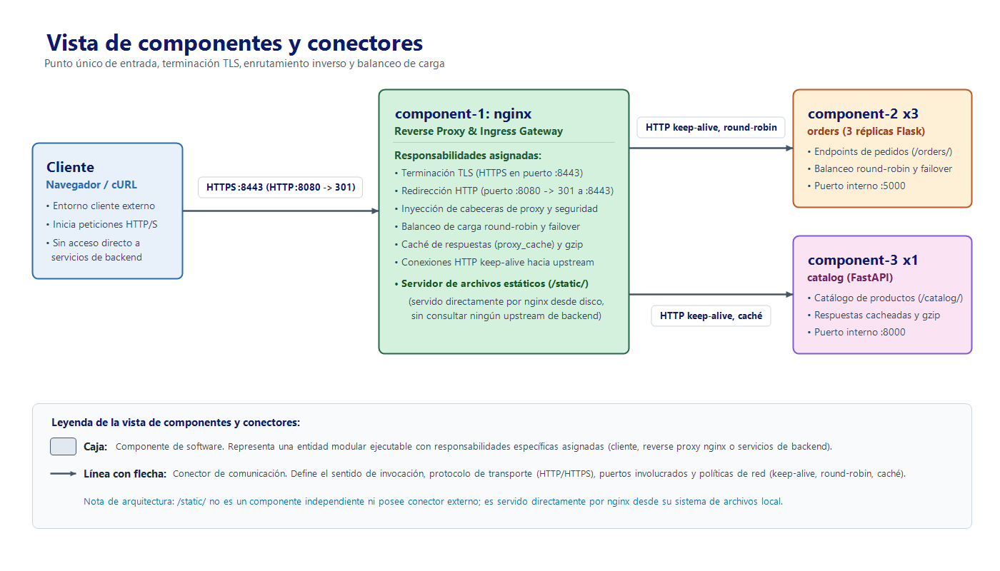

# Reverse Proxy con nginx — Laboratorio 5, grupo 2A

Implementación del patrón de seguridad **Reverse Proxy** usando nginx sin
modificar como componente listo para usar. nginx es el único punto de entrada:
termina TLS, oculta los backends en una red interna de Docker, balancea entre
réplicas y acelera las respuestas con caché, gzip y archivos estáticos.

- **Guía técnica completa:** [`l5_2a.md`](l5_2a.md) (patrón, escenario de
  calidad, pasos, configuración, resultados y recomendaciones).
- **Vistas arquitectónicas:** [`img/`](img/).



## Estructura

```text
README.md
l5_2a.md                       # guía técnica
img/                           # vista de componentes y vista de despliegue
reverse-proxy/
  docker-compose.yml           # topología segura: solo nginx publica puertos
  docker-compose.insecure.yml  # línea base "antes": backends publicados
  component-1/                 # nginx: nginx.conf, snippets/, TLS, static/
  component-2/                 # orders (Flask), 3 réplicas
  component-3/                 # catalog (FastAPI), 1 instancia
  tests/before-after.sh        # evidencia antes/después con curl
```

Cada `component-N/` tiene su propio README con lo que contiene y cómo
probarlo.

## Requisitos

Docker con Docker Compose, `openssl`, `bash` y `curl`.

## Inicio rápido

```bash
git clone https://github.com/TINTOrganization/lab-5.git
cd lab-5/reverse-proxy
./component-1/gen-certs.sh                 # certificado autofirmado (una vez)
docker compose up --build -d --scale component-2=3
curl --cacert component-1/certs/server.crt https://localhost:8443/orders/
```

| URL | Qué hace |
|---|---|
| `https://localhost:8443/orders/` | orders, balanceado entre 3 réplicas con failover |
| `https://localhost:8443/catalog/` | catalog, con caché (`X-Cache-Status`) y gzip |
| `https://localhost:8443/static/index.html` | archivo servido por nginx, sin backend |
| `http://localhost:8080/...` | redirección `301` a HTTPS |
| cualquier otra ruta | `404` |

Para reproducir toda la evidencia (línea base insegura, seguridad, balanceo,
failover, caché, gzip y estáticos):

```bash
bash tests/before-after.sh
```

El script levanta y baja los dos Compose por su cuenta y necesita libres los
puertos `5000`, `8000`, `8080` y `8443`.

Para apagar el stack: `docker compose down`.

## Integrantes

Juan David Guarnizo Gutierrez, Camilo Andrés Herrera Gutiérrez, Camilo Ferney
Londoño Moreno, Angel Humberto Olivera Pinzón, Pablo Esteban Olaya Arias,
Daniel Alberto Garzon Fraile.

Arquitectura de Software 2026-II, Universidad Nacional de Colombia.
