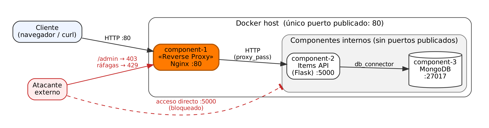

<div class="cover">

**Software Architecture · 2026-II** — Universidad Nacional de Colombia\
Profesor: Jeisson Andrés Vergara Vargas

| | |
|---|---|
| **Equipo** | X |
| **Integrantes** | Angel Olivera |
| **Patrón asignado** | Reverse Proxy Pattern |

</div>

# 1. Vista arquitectónica



| Elemento | Descripción |
|---|---|
| component-1 | Reverse proxy (Nginx). Único componente con un puerto publicado (80). Recibe todas las peticiones, las filtra y las reenvía. |
| component-2 | API de `items` (Python + Flask). Puerto interno 5000, no publicado. Tiene un endpoint sensible: `/admin/stats`. |
| component-3 | Base de datos (MongoDB). Puerto interno 27017, no publicado. |
| Cliente → component-1 | Conector HTTP por el puerto 80. |
| component-1 → component-2 | Conector HTTP (`proxy_pass`). |
| component-2 → component-3 | Conector de base de datos (`db_connector`). |

# 2. Guía técnica

## 2.1. Descripción del patrón

Un **reverse proxy** es un componente intermediario que se ubica delante de los servicios de un sistema. Los clientes solo se comunican con el proxy; este recibe cada petición, decide si la deja pasar y la reenvía al servicio interno correspondiente.

**Propósito:** que los servicios internos no queden expuestos directamente. Así se reduce la superficie de ataque y los controles de seguridad (bloqueo de rutas, límite de peticiones, ocultar información del servidor) se aplican en un solo lugar.

## 2.2. Escenario de calidad

| Parte | Descripción |
|---|---|
| **Fuente** | Un atacante externo, no autenticado. |
| **Estímulo** | Intenta acceder directamente a la API o a su ruta administrativa, y envía muchas peticiones seguidas para saturarla. |
| **Artefacto** | API de items (component-2) y base de datos (component-3). |
| **Entorno** | Operación normal. |
| **Respuesta** | El reverse proxy es el único punto de entrada: bloquea la ruta `/admin`, limita las peticiones por IP y no revela la tecnología del servidor. |
| **Medida** | 0 servicios internos accesibles desde fuera; 100 % de las peticiones a `/admin` rechazadas (403); máximo 5 peticiones/s por IP (ráfaga de 10) y el resto rechazadas (429). |

**Atributos de calidad:** confidencialidad (los servicios internos y la ruta administrativa quedan ocultos) y disponibilidad (el exceso de peticiones se detiene en el proxy).

## 2.3. Pasos de implementación

**Prerrequisitos:** un computador con un sistema operativo basado en Unix y Docker instalado.

Crear una carpeta `reverse-proxy-pattern`.

### Paso 1 — Component 2: Items API

a. Dentro de `reverse-proxy-pattern`, crear la carpeta `component-2` y dentro de ella la carpeta `app`.

b. Dentro de `app`, crear el archivo `app.py`:

```python
import os
from flask import Flask, jsonify, request
from pymongo import MongoClient

app = Flask(__name__)

client = MongoClient(os.environ["DB_HOST"])
collection = client[os.environ["DB_NAME"]]["items"]

@app.route("/items", methods=["GET"])
def get_items():
    items = [
        {"id": str(i["_id"]), "name": i["name"], "description": i["description"]}
        for i in collection.find()
    ]
    return jsonify(items)

@app.route("/items", methods=["POST"])
def create_item():
    data = request.json
    name = data.get("name")
    description = data.get("description")

    if not name or not description:
        return jsonify({"error": "Missing name or description"}), 400

    collection.insert_one({"name": name, "description": description})
    return jsonify({"status": "Item created"}), 201

# Endpoint sensible: solo debe usarse desde la red interna
@app.route("/admin/stats", methods=["GET"])
def admin_stats():
    return jsonify({
        "total_items": collection.count_documents({}),
        "db_host": os.environ["DB_HOST"]
    })

if __name__ == "__main__":
    app.run(host="0.0.0.0", port=5000)
```

c. Dentro de `component-2`, crear el archivo `requirements.txt`:

```text
flask
pymongo
```

d. Dentro de `component-2`, crear el archivo `Dockerfile`:

```dockerfile
FROM python:3.11-slim
WORKDIR /app
COPY requirements.txt .
RUN pip install --no-cache-dir -r requirements.txt
COPY app ./app
CMD ["python", "app/app.py"]
```

### Paso 2 — Component 3: Base de datos

No requiere código. Se usa la imagen oficial de MongoDB.

### Paso 3 — Component 1: Reverse Proxy

a. Dentro de `reverse-proxy-pattern`, crear la carpeta `component-1`.

b. Dentro de `component-1`, crear el archivo `nginx.conf`:

```nginx
# Ocultar la versión de Nginx en las respuestas
server_tokens off;

# Máximo 5 peticiones por segundo por IP (con ráfaga de 10)
limit_req_zone $binary_remote_addr zone=api_limit:10m rate=5r/s;
limit_req_status 429;

# Servicio interno (no expuesto al exterior)
upstream items_api {
    server component-2:5000;
}

server {
    listen 80;
    server_name localhost;

    # Tamaño máximo del cuerpo de una petición
    client_max_body_size 1m;

    # Las rutas administrativas no se publican hacia afuera
    location /admin {
        return 403;
    }

    # Todo lo demás se reenvía al servicio interno
    location / {
        limit_req zone=api_limit burst=10 nodelay;

        proxy_pass http://items_api;
        proxy_set_header Host $host;
        proxy_set_header X-Real-IP $remote_addr;
        proxy_set_header X-Forwarded-For $remote_addr;
    }
}
```

c. Dentro de `component-1`, crear el archivo `Dockerfile`:

```dockerfile
FROM nginx:alpine
COPY nginx.conf /etc/nginx/conf.d/default.conf
```

Qué hace cada parte de la configuración:

| Configuración | Propósito |
|---|---|
| `server_tokens off` | Las respuestas no muestran la versión de Nginx. |
| `limit_req_zone` / `limit_req` | Limita cada IP a 5 peticiones por segundo (ráfaga de 10). El exceso recibe 429. |
| `client_max_body_size 1m` | Rechaza peticiones de más de 1 MB (413). |
| `location /admin { return 403; }` | La ruta administrativa no es accesible desde fuera. |
| `proxy_pass` | Reenvía las peticiones válidas a component-2. |
| `X-Real-IP` / `X-Forwarded-For` | El servicio interno recibe la IP real del cliente. |

### Paso 4 — Despliegue

a. Dentro de `reverse-proxy-pattern`, crear el archivo `docker-compose.yml`. **Solo component-1 tiene `ports`**; component-2 y component-3 no publican ningún puerto:

```yaml
services:

  component-1:
    build: ./component-1
    container_name: component-1
    ports:
      - "80:80"
    depends_on:
      - component-2

  component-2:
    build: ./component-2
    container_name: component-2
    environment:
      DB_HOST: mongodb://component-3:27017
      DB_NAME: db
    depends_on:
      - component-3

  component-3:
    image: mongo
    container_name: component-3
```

b. Construir y levantar los contenedores:

```bash
docker compose up --build
```

### Paso 5 — Pruebas

a. Crear un item a través del proxy:

```bash
curl -X POST http://localhost/items \
  -H "Content-Type: application/json" \
  -d '{"name": "SwArch", "description": "2026-II"}'
```

Respuesta: `{"status": "Item created"}`.

b. Consultar los items a través del proxy:

```bash
curl http://localhost/items
```

c. Intentar acceder directamente a la API (sin pasar por el proxy):

```bash
curl http://localhost:5000/items
```

Respuesta: `Connection refused`, porque component-2 no publica su puerto.

d. Intentar acceder a la ruta administrativa:

```bash
curl -i http://localhost/admin/stats
```

Respuesta: `403 Forbidden`. Desde la red interna sí funciona:

```bash
docker exec component-1 wget -qO- http://component-2:5000/admin/stats
```

e. Revisar las cabeceras de respuesta:

```bash
curl -I http://localhost/items
```

Se ve `Server: nginx` sin versión, en lugar de `Server: Werkzeug/... Python/...`.

f. Enviar 20 peticiones seguidas:

```bash
for i in $(seq 1 20); do
  curl -s -o /dev/null -w "%{http_code}\n" http://localhost/items
done
```

Las primeras peticiones responden `200` y las que superan el límite responden `429`.

## 2.4. Resultados

Comparación con un despliegue sin reverse proxy, como el del Laboratorio 2, donde cada servicio publica su propio puerto:

| Prueba | Sin reverse proxy | Con reverse proxy |
|---|---|---|
| Puertos publicados | API (5000) y base de datos (27017) | Solo el proxy (80) |
| `curl localhost:5000/items` | 200 | Conexión rechazada |
| `GET /admin/stats` desde fuera | 200 (muestra datos internos) | 403 |
| Cabecera `Server` | `Werkzeug/... Python/...` | `nginx` |
| 20 peticiones seguidas | 20 × 200 | ≈ 11 × 200 y el resto 429 |

**Mejoras observadas:**

- Desde fuera ya no se puede llegar a la API ni a la base de datos; solo al proxy.
- La ruta administrativa queda protegida sin modificar el código de la API.
- El exceso de peticiones se detiene en el proxy, antes de llegar a la API.
- Las respuestas no revelan qué tecnología usa el backend.

## 2.5. Recomendaciones

1. Publicar con `ports` únicamente el reverse proxy; los demás servicios no deben tener puertos publicados.
2. Bloquear en el proxy todas las rutas que no deban ser públicas (`/admin`, `/internal`, `/metrics`, etc.).
3. Ajustar los valores de `rate` y `burst` según el tráfico real del sistema; los de esta guía son de prueba.
4. Validar la configuración después de cada cambio con `docker exec component-1 nginx -t`.
5. Combinar este patrón con el **Secure Channel Pattern** (HTTPS en el proxy) y el **Network Segmentation Pattern** para aumentar la protección.
