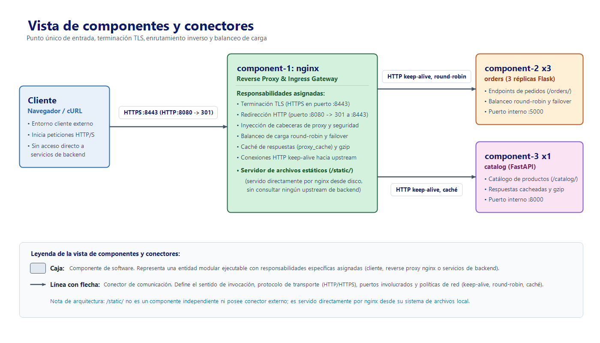
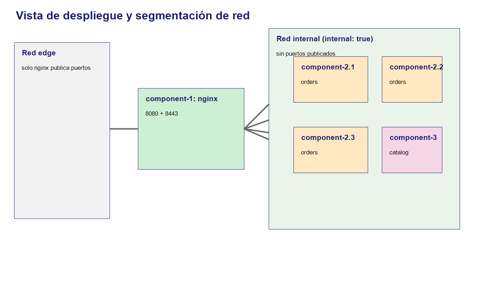

# Laboratorio 5 — Reverse Proxy

**Curso:** Arquitectura de Software 2026-II

**Integrantes:** Juan David Guarnizo Gutierrez, Camilo Andrés Herrera Gutiérrez, Camilo Ferney Londoño Moreno, Angel Humberto Olivera Pinzón, Pablo Esteban Olaya Arias,  Daniel Alberto Garzon Fraile

## 1. Descripción y propósito del patrón

El patrón **Reverse Proxy** coloca un único punto de entrada delante de los
servicios internos. En este laboratorio nginx termina TLS, recibe las
peticiones del cliente y las reenvía a `orders` o `catalog` por una red Docker
interna. Los backends no publican puertos al host, por lo que un cliente
externo no puede conectarse a ellos directamente.

La implementación usa nginx como componente listo para usar; no se construye
un proxy propio. Además de ocultar los servicios, la configuración demuestra
balanceo round-robin y failover para tres réplicas de orders, caché y gzip para
catalog, archivos estáticos servidos por nginx y conexiones keep-alive hacia
los backends.

## 2. Escenario de calidad

**Fuente:** un cliente externo realiza solicitudes HTTPS al sistema.

**Estímulo:** intenta acceder directamente a un backend, enviar un
`X-Forwarded-For` falso, consultar endpoints internos, repetir una consulta
costosa o continuar usando orders mientras una réplica está detenida.

**Artefacto:** los servicios `orders` (`component-2`, tres réplicas) y
`catalog` (`component-3`), detrás de nginx (`component-1`).

**Entorno:** operación normal, desplegado con Docker Compose en un solo host.

**Respuesta esperada:** solo nginx queda expuesto; HTTP redirige a HTTPS; TLS
termina en nginx; las cabeceras de reenvío son reemplazadas; los endpoints
internos responden `404`; las consultas repetidas usan caché; las respuestas
grandes se comprimen; y otra réplica atiende si una instancia falla.

**Medida:** únicamente los puertos `8080` y `8443` de `component-1` aparecen
publicados. Las 20 solicitudes a orders muestran tres hostnames, una prueba
con una réplica detenida devuelve solo `200`, la segunda consulta a catalog
devuelve `X-Cache-Status: HIT`, y una respuesta con `Accept-Encoding: gzip`
incluye `Content-Encoding: gzip`.

**Atributos de calidad:** principalmente confidencialidad (los backends, sus
versiones y sus endpoints internos quedan ocultos detrás del proxy); además
disponibilidad (failover entre réplicas) y desempeño (caché, gzip y
keep-alive).

## 3. Vista arquitectónica

La vista de componentes y conectores muestra el punto único de entrada y las
rutas principales:



La vista de despliegue muestra la separación entre la red pública y la red
interna. Solo nginx está conectado a ambas redes:



## 4. Estructura del proyecto

```text
lab5-reverse-proxy/
  docker-compose.yml
  docker-compose.insecure.yml
  component-1/                 # nginx, TLS y archivos estáticos
  component-2/                 # orders, Flask
  component-3/                 # catalog, FastAPI
  tests/before-after.sh
  img/vista-componentes.png
  img/vista-despliegue.png
  l5_2a.md
```

## 5. Implementación

### 5.1 Topología segura

`docker-compose.yml` crea una red `internal: true` para los backends y una
red `edge` para nginx. Los únicos puertos publicados son los de nginx:

```yaml
component-1:
  build: ./component-1
  container_name: component-1
  ports:
    - "8443:8443"
    - "8080:8080"
  networks:
    - edge
    - internal

component-2:
  build: ./component-2
  deploy:
    replicas: 3
  networks:
    - internal

component-3:
  build: ./component-3
  networks:
    - internal
```

La sección `deploy.replicas` documenta la topología. Con Docker Compose local
se ejecuta además `--scale component-2=3`, porque ese parámetro garantiza las
tres instancias aunque el backend Compose no aplique `deploy.replicas`.

### 5.2 Línea base insegura

`docker-compose.insecure.yml` publica los backends para hacer visible la
diferencia antes/después. La línea base ejecuta una instancia de orders y
publica sus puertos directamente:

```yaml
component-2:
  ports:
    - "5000:5000"

component-3:
  ports:
    - "8000:8000"
```

Por eso, antes del proxy `curl http://localhost:5000/orders/` y
`curl http://localhost:8000/catalog/` responden directamente. Después de
levantar el Compose seguro, esos mismos puertos no tienen listener; el cliente
debe usar únicamente nginx en `8443` o el redirect de `8080`. Una IP `172.x`
de un contenedor puede seguir siendo accesible desde el mismo host Docker:
esa observación no contradice la segmentación para clientes externos y no es
la prueba usada en este laboratorio.

Los puertos `5000` y `8000` del host deben estar libres antes de ejecutar la
línea base; si otro proceso o contenedor los ocupa, `docker compose up` falla
con `port is already allocated`.

### 5.3 TLS, cabeceras y rutas

El certificado local se genera con:

```bash
cd lab5-reverse-proxy
./component-1/gen-certs.sh
```

En Windows, si Git Bash usa el binario nativo de OpenSSL y no puede resolver
la ruta `/tmp`, crear los mismos archivos desde PowerShell:

```powershell
$certDir = "component-1\certs"
New-Item -ItemType Directory -Force $certDir
openssl req -x509 -newkey rsa:2048 -nodes -sha256 -days 365 `
 -keyout "$certDir\server.key" -out "$certDir\server.crt" `
 -subj "/CN=localhost" `
 -addext "subjectAltName=DNS:localhost,IP:127.0.0.1"
```

El servidor HTTP escucha en `8080` y devuelve `301` hacia `https://$host:8443`.
El servidor HTTPS escucha en `8443`, permite TLS 1.2 y 1.3, desactiva la
versión de nginx y agrega las cabeceras de seguridad definidas en
`component-1/snippets/security-headers.conf`.

Las rutas públicas son `/orders/`, `/catalog/` y `/static/`. `/health`,
`/orders/health`, `/catalog/docs`, `/catalog/redoc`, `/catalog/openapi.json` y
cualquier otra ruta responden `404`. La ruta `/static/` usa `alias`, por lo
que nginx sirve el archivo sin contactar a ningún backend.

### 5.4 Balanceo y failover

El upstream de orders recibe las tres direcciones del servicio Compose y usa
round-robin:

```nginx
upstream orders {
    zone orders 64k;
    server component-2:5000 max_fails=1 fail_timeout=10s;
    keepalive 16;
}

location /orders/ {
    proxy_pass http://orders/;
    proxy_next_upstream error timeout http_502 http_503 http_504;
    proxy_next_upstream_tries 3;
    proxy_connect_timeout 2s;
    include /etc/nginx/snippets/proxy-headers.conf;
}
```

`zone orders 64k` guarda el estado del upstream en memoria compartida: sin
ella cada worker de nginx lleva su propio contador round-robin y el reparto
entre las tres réplicas sale desigual (por ejemplo 15/7/8 en lugar de
10/10/10).

`proxy_next_upstream` permite que una solicitud GET pase a otra réplica si la
primera falla. `proxy_http_version 1.1` y `Connection ""` se configuran en el
include compartido para conservar conexiones hacia el upstream.

### 5.5 Caché, gzip y estáticos

Catalog usa una zona de caché y expone el estado al cliente:

```nginx
proxy_cache_path /var/cache/nginx/catalog levels=1:2
                 keys_zone=catalog_cache:10m max_size=100m
                 inactive=60s use_temp_path=off;

location /catalog/ {
    proxy_pass http://catalog/;
    proxy_cache catalog_cache;
    proxy_cache_valid 200 30s;
    proxy_cache_key $scheme$request_method$host$request_uri;
    add_header X-Cache-Status $upstream_cache_status always;
}
```

La compresión se habilita globalmente en `http {}`:

```nginx
gzip on;
gzip_vary on;
gzip_min_length 256;
gzip_proxied any;
gzip_types application/json application/javascript text/css text/plain
            application/xml;
```

## 6. Ejecución y pruebas

Desde `lab5-reverse-proxy/`, ejecutar:

```bash
MSYS_NO_PATHCONV=1 ./component-1/gen-certs.sh
docker compose up --build -d --scale component-2=3
docker compose ps
```

Debe observarse `component-1` con `0.0.0.0:8080->8080` y
`0.0.0.0:8443->8443`; `component-2` y `component-3` no deben mostrar
puertos publicados.

El script reproducible reúne la evidencia antes/después:

```bash
bash tests/before-after.sh
```

Pruebas adicionales para el failover:

```bash
docker compose ps component-2
docker stop <nombre-de-una-replica>
for i in $(seq 1 20); do
  curl -sk -o /dev/null -w "%{http_code}\n" \
    https://localhost:8443/orders/
done | sort | uniq -c
docker start <nombre-de-la-replica>
```

El resultado esperado es una sola línea con `200` y ninguna respuesta `502` o
`504`. Para verificar la configuración nginx:

```bash
docker exec component-1 nginx -t
```

La salida debe contener `syntax is ok` y `test is successful`.

## 7. Resultados

La integración se ejecutó con Docker Desktop usando los archivos de los tres
componentes y los archivos D de este branch. El script
`tests/before-after.sh` terminó con código `0`.

| Comprobación | Resultado obtenido |
|---|---|
| Topología segura | `component-1` publica `8080` y `8443`; `component-2` y `component-3` no publican puertos. |
| Acceso directo | Antes, `localhost:5000` y `localhost:8000` respondieron directamente; después, `localhost:5000` no tuvo listener. |
| HTTPS/HTTP | HTTPS respondió el JSON de orders; HTTP devolvió `301 Moved Permanently`. |
| Seguridad | `Server: nginx` no incluyó versión; se observaron HSTS, `nosniff`, `DENY`, `no-referrer` y CSP. |
| Rutas internas | `/health`, `/orders/health`, `/catalog/docs` y `/unknown` devolvieron `404`. |
| `X-Forwarded-For` | nginx registró el valor enviado, pero su configuración mostró que reenvía `$remote_addr`, no el valor falsificado. |
| Balanceo | 20 solicitudes rotaron entre tres instancias: `7`, `7` y `6` respuestas por hostname en la ejecución final. |
| Failover | 10/10 solicitudes devolvieron `200` mientras una réplica de orders estaba detenida. |
| Configuración | `nginx -t` mostró `syntax is ok` y `test is successful`. |
| Caché | La primera consulta tardó `0.529203s` con `MISS`; la segunda `0.034248s` con `HIT`. |
| Gzip | La respuesta incluyó `Vary: Accept-Encoding` y `Content-Encoding: gzip`; el cuerpo pasó de 5912 bytes sin gzip a 717 bytes con gzip. |
| Archivos estáticos | `/static/index.html` devolvió HTML y el access log de nginx registró `upstream=-`: ningún backend recibió la petición. |

## 8. Recomendaciones

1. Sustituir el certificado autofirmado por un certificado emitido por una
   autoridad confiable y automatizar su renovación.
2. Mantener los backends sin `ports:` en el Compose de producción y separar la
   red pública de la red interna.
3. Revisar la política de caché antes de habilitarla para respuestas
   personalizadas; la clave debe incluir todos los parámetros que cambien el
   contenido.
4. Mantener `proxy_set_header X-Forwarded-For $remote_addr` en un include
   centralizado para evitar que cada backend acepte cabeceras del cliente.
5. Añadir observabilidad de latencia, tasa de errores, estado de caché y
   disponibilidad de upstreams antes de operar el patrón en producción.
6. El balanceo de este laboratorio usa resolución DNS al iniciar nginx. Si
   cambian las direcciones de las réplicas, recargar nginx o adoptar una
   estrategia de resolución dinámica apropiada para producción.
